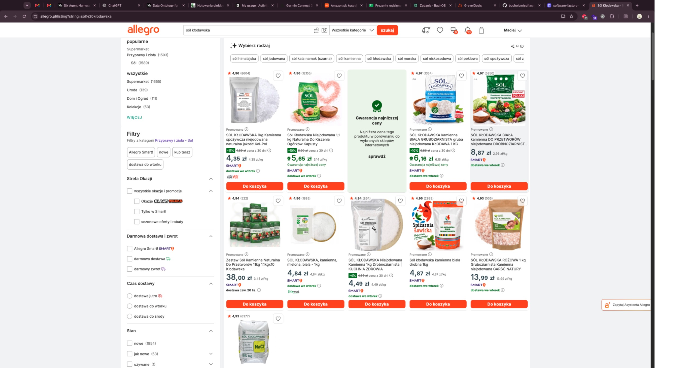

# Local Software Factory

[](https://github.com/bucholcm/software-factory/actions/workflows/tests.yml)
[](pyproject.toml)


[](LICENSE)

Turn project tickets into isolated implementations, tested changes, and
independent reviews. Start from Codex or OpenCode and follow progress in a
terminal pane.

The focus is recoverable local delivery: resume owned work after a supervisor
restart, bind tests and independent review to a commit, and verify a checkpoint
before integration. Application activation and data recovery have separate,
explicit boundaries.

This is a pilot for trusted local projects. Test and release commands run with
the supervisor account's permissions. Review the [security policy](SECURITY.md)
before running a project, and the [public-release assessment](security_best_practices_report.md)
before publishing or deploying it.

The supervisor runs independently of chat sessions. Herdr shows agent terminals
and status; Codex CLI executes bounded jobs and independent review sessions.
OpenCode has a read-only planning/review adapter; its implementation sandbox is
not configured in this pilot. BuchOS is the first project adapter; cloud
execution is future work.

## Beads → Scotty → Factory → Herdr

Requirements and product decisions stay with the human. Beads stores tasks,
ownership and native dependency edges. **Bead Me Up, Scotty** shows the board
and graph over those records. The factory handles eligible work, tests and
independent review; Herdr shows the terminals and status.

A decision blocks only dependent tasks. Independent scoped work can continue.
An epic groups tasks; actual prerequisites use blocking edges. Review belongs
to an exact commit, and completion is recorded only after verification.

See the [workflow guide and runnable synthetic graph](docs/beads-scotty-workflow.md).
You can also ask for `$factory graph` in Codex or `/factory graph` in OpenCode.
The demo creates real Beads relations for Scotty without starting model workers.

[](docs/images/scotty-dependency-graph.png)

*Actual Scotty screenshot of the synthetic demo project, with native Beads
relations and read-only mode enabled.*

## See it in Herdr

[](docs/images/herdr-factory-status.png)

*Illustrative Herdr layout: agents on the left, factory status in the middle,
and a delivery report in the coding-agent terminal on the right. The ticket,
status, and delivery report are synthetic examples; this is not a native window
screenshot, and no model job ran to produce this image.*

Keep your coding session in one pane and factory status in another. From the
factory checkout, run:

```sh
python -m scripts.status_panel --config /private/path/config.json
```

The view refreshes every five seconds and shows readiness, mode, heartbeat,
active workers, recent jobs, and blockers. Ctrl+C closes the view while the
supervisor continues running. Use `--once` for a single snapshot or `--plain`
for output without terminal colors.

While a verified worker is alive, the panel shows **WORK IN PROGRESS**, the
current stage, the running attempt's elapsed time, total age including waits,
and verified implementation/test/review milestones for the current revision.
Fixes invalidate the affected milestones and show a new verification cycle.
Retry waits, blocked work, stale supervisors and reviewed branches have distinct
states. A coordinator can be idle between polls while its worker is running.
Use `--interval 1` for a timer that refreshes every second. The same read-only
progress projection is available in `factory status` JSON. New model attempts
record runtime token usage and show known totals/coverage in the panel, alongside
explicit API-equivalent cost estimates. Model provenance, missing historical
data and partial costs remain visible; see the [usage and cost guide](docs/usage-and-costs.md).
Use `$factory usage [ID]` or `/factory usage [ID]` for the read-only report.
Repeat `--config` to show an application factory and its repair supervisor in
one view. Active work is shown first, followed by waiting or blocked jobs; the
panel keeps four jobs visible while JSON status includes the full history.

To open it beside the current pane in Herdr:

```sh
herdr pane split --current --direction right --cwd "$PWD" --no-focus
# Replace PANE_ID with result.pane.pane_id from the split response.
herdr pane run PANE_ID 'python -m scripts.status_panel --config /private/path/config.json'
```

## Workflow and modes

Project dependencies and operational feedback are described in the
[environment and reliability-loop guide](docs/reliability-loop.md). An explicit
profile prepares a fresh worktree before the model starts, checks system tools,
and blocks environment failures without spending code-fix retries. Sanitized
incidents survive restarts and can drive bounded factory repair jobs in a
separate supervisor, with tests and independent review before controlled rollout.

The journaled workflow is implementation → deterministic checks → independent
review of the exact commit → fixes/retest → verified code checkpoint → automatic
integration. A killed supervisor adopts its existing worker, rather than starting
a duplicate. Retry, timeout and fix-loop limits make failures visible.

Existing configurations retain their documentation-only defaults. Three modes
are available through `set-mode`:

| Mode | Task intake | Automatic code integration |
| --- | --- | --- |
| `documentation` | Ordinary documentation | Documentation only |
| `source-review` | Scoped source and documentation | Documentation only; source stays tested/reviewed on its branch |
| `source-integrate` | Scoped source and documentation | Exact tested/reviewed revision after fresh security gates and verified code backup |

Source integration requires configured `security_gates` (lists of argv, no shell)
and `integration_checkout_isolated: true`. The latter is an explicit project
contract: no running application or development server may serve the integration
checkout. In particular, Vite HMR would activate frontend changes on merge.
If runtime separation has not been verified, use `source-review`. Mode switching
does not establish that separation. Source integration refuses a missing, stale,
wrong-revision or wrong-policy security receipt. Scanner failures enter the
bounded fix loop; existing maintenance findings are never declared clean.

Application activation is separate and explicit. Integrating Git does not call
migrations or restore application data. The release adapter described below
must be configured before activation; no live BuchOS release adapter is assumed.

Task intake reads Beads and checks GitHub reviews before claiming open,
unassigned tasks labeled `factory-pilot` and `ready-for-development`. It preserves
explicit file scopes recorded as `factory_paths` in Beads metadata. Scopes can
name files or directories; private-state paths and symlinks are rejected.
Disjoint scoped work can
continue while a decision blocks another task. Product questions become separate
decision Beads with native blocking edges; a substantive answer in the decision's
close reason resumes only its dependent job. It preserves
other agents' work and enforces the global task limit conservatively. The initial
pilot processes one job at a time. Finished work is verified on local `main` before
closing its Bead. It does not push to GitHub in this first rollout.

## Run and inspect

Requires Python 3.11+, Git, authenticated Codex CLI, Beads and GitHub CLI.
Use `python -m factory --help` from this product directory.

```sh
python -m factory --config /private/path/config.json init \
  --repo /path/to/buchos --state-dir /private/path/state
python -m factory --config /private/path/config.json run
python -m factory --config /private/path/config.json status
python -m factory --config /private/path/config.json status --watch
python -m factory --config /private/path/config.json set-mode source-review
python -m factory --config /private/path/config.json submit \
  --project /path/to/current/project --task PROJECT-TICKET
```

`submit` selects exactly that ticket and shares an intake lock with automatic
dispatch. It checks repository identity, supervisor readiness, task eligibility,
scope reservations in active work/review, global capacity and GitHub findings.
An existing job is returned without creating a duplicate or resuming unrelated
work. Mode changes are picked up by the supervisor on its next iteration.

The `skills/factory` skill provides `$factory TICKET` and `$factory status` from
Codex's current project, including linked Git worktrees. Install its folder into
`~/.agents/skills/factory` (a symlink is supported). Its `scripts/project.py`
helper discovers only configurations belonging to that Git repository; it
requires a selection when multiple configurations match. Each new project needs
its own configuration and quality gates. Beads is the current tracker adapter.

OpenCode can use the same skill through its `~/.agents/skills` compatibility
discovery. To add `/factory TICKET` and `/factory status`, link
`integrations/opencode/commands/factory.md` into
`~/.config/opencode/commands/factory.md`, then reload OpenCode configuration.
The command uses the current project and the same supervisor; it does not change
the configured execution runtime. `/factory TICKET` in OpenCode can submit work
to a factory configured with the Codex execution runtime. OpenCode's native
implementation runtime stays disabled until an enforced sandbox is implemented
and validated with negative access tests. The former
`opencode_implementation_sandbox: "verified"` flag is rejected: a successful
cooperative edit and an untouched canary do not establish containment. The legacy
`scripts/verify_opencode_sandbox.py` command now exits unsuccessfully without
launching an agent. OpenCode review jobs retain the `plan` agent and can pin a
requested model using `opencode_model`; this is a planning mode, not an OS sandbox.


`scripts/install_local.py` installs a reviewed `main` revision to a separate
durable directory, optional isolated scanner tools, and a per-user macOS
LaunchAgent. Without `--start` it prepares a candidate service definition;
`--start` explicitly activates it and requires a fresh, live, ready heartbeat.
Existing installations are never overwritten by this installer.

The service runs committed code from a versioned, hash-verified artifact under
the private state directory's `runtimes/REVISION`, with that artifact as its
working directory and Python module path. It does not import the product from
Documents. This avoids the observed pre-Python working-directory stall; it does
not grant the service access to a protected project directory. Repository/tracker
health must still be checked after activation. No macOS privacy settings change.

```sh
python scripts/install_local.py --destination /path/to/software-factory \
  --repo /path/to/buchos --state-dir /private/path/factory-state \
  --install-scanners --start
launchctl bootout gui/$(id -u)/dev.software-factory.buchos
```

The last command stops the supervisor; already-running bounded workers finish
and keep their completion receipts for the next start. To restart, bootstrap the
generated `~/Library/LaunchAgents/dev.software-factory.buchos.plist`.

For an existing installation, prepare a reviewed service repair first:

```sh
python scripts/repair_local_service.py --source /path/to/reviewed/software-factory \
  --config /private/path/factory-state/config.json --expected-revision REVIEWED_SHA
```

The result names the private runtime artifact and candidate plist. Stop the
existing supervisor and its Herdr restart loop before repeating the command with
`--activate`; a live verified supervisor prevents activation. The repair preserves
configuration, execution records, tools and backups. If activation fails, it
restores only this exact owned service's previous plist and recorded enabled/
loaded state. The local activation journal records whether rollback completed.

Readiness requires a new startup identity, fresh timestamps, a ready heartbeat
and matching live PID identity; a stale status file or merely running launchctl
process is insufficient. The LaunchAgent is configured to run at login and restart
after failure while the Mac is awake. A successful current activation does not
verify fresh-login behavior: that remains a separate manual E2E check. It does not
run while the machine is asleep or powered off. Herdr remains the fallback host
until native service readiness and project access are observed.

## Recovery

Each automatic code integration first creates a private Git bundle,
validates it, and clones it into a disposable directory to verify recovery of the
previous `main`. An integration journal survives a crash between Git and the
execution database. Code recovery never rewinds application data.

```sh
python -m factory --config /private/path/config.json checkpoint
python -m factory --config /private/path/config.json restore-code-into \
  --checkpoint /private/path/state/backups/CHECKPOINT_ID \
  --destination /new/recovery/directory
```

Restoration creates a new directory, verifies the bundle hash, and checks out the
checkpoint's recorded base revision. It does not overwrite a checkout. Backups
are local protection against software failures; off-device/disaster recovery is
not configured.

State checkpoints additionally support an explicit inventory of SQLite databases
and ordinary mutable files. SQLite online backup includes WAL data; application
constructors are never called before backup. Every published checkpoint is
hashed and rehearsed by restoring code and state into an isolated new directory.
An interrupted or failed snapshot is never published as verified.

```sh
python -m factory --config /private/path/config.json checkpoint-state
python -m factory --config /private/path/config.json restore-state-into \
  --checkpoint /private/path/checkpoint --destination /new/isolated/directory
python -m factory --config /private/path/config.json activate --revision EXACT_SHA
python -m factory --config /private/path/config.json recover-release
```

`config.release` supplies an explicit `inventory` of `{name, kind, path}` records
(`kind` is `sqlite` or `file`, `path` is absolute), `initial_revision`, and argv
under `commands.stop`, `verify_stopped`, `start`, `health`, optionally `migrate`.
Commands can use `{release}` and `{revision}` placeholders and must be idempotent.
`verify_stopped` must attest that **all** application writers are stopped.
Commands run from an isolated artifact for the exact revision, with output
suppressed. Required runtime dependencies must be provisioned by the adapter.
For each SQLite resource, `compatible_schemas[SHA][name]` explicitly lists
accepted schema fingerprints from the private checkpoint manifest.

Activation requires an integrated, tested and independently approved job. It
quiesces writers, creates a coordinated state checkpoint, then migrates/starts
the candidate and checks health. Standalone `checkpoint-state` promises only
per-resource consistency. Journaling survives process death. Failed activation
rolls back code only when the previous release accepts the live schema; later
user writes are preserved. A schema-changing failure remains stopped with a
concrete blocker and requires reconciliation or isolated recovery. No command
restores a historical database over live data.

## Maintenance

The service schedules read-only checks daily. A command can trigger them now:

```sh
python -m factory --config /private/path/config.json maintenance
```

Scanners receive a disposable copy of approved tracked HEAD files, not the
working directory, private databases, environment files, or untracked user data.
An explicitly configured application Python interpreter supplies installed
package metadata only. Reports retain normalized package/advisory/rule IDs,
never raw secret matches or source snippets. Missing tools, partial coverage,
scanner failures and stale reports are visible, never reported as clean.

The reusable triage skill is `skills/factory-maintenance/SKILL.md`. Optional
tools include pip-audit, npm, Bandit, Semgrep, Gitleaks and Trivy. Docker checks
are not applicable if a project has no tracked container definitions. Docker
tag/digest update automation still needs an update-manager adapter.

## Verification

The Tests workflow runs deterministic tests on macOS and Linux with Python 3.11
and 3.13. CI uses synthetic data and does not need model credentials or private
application state. Model-backed smoke tests are separate, explicit commands.

```sh
python -m unittest discover -s tests -v
python -m scripts.smoke_runtime
python -m scripts.smoke_runtime --source --restart \
  --security-python /path/to/python-with-bandit
```

The second command spends model tokens on an actual isolated implementation,
independent review and automatic integration. It never opens BuchOS financial
data. Process recovery tests need normal user process-inspection permissions.

## License

Licensed under the [MIT License](LICENSE).
