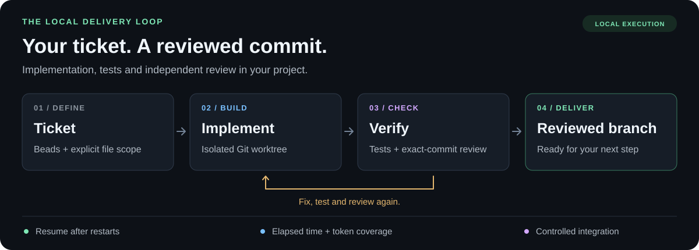
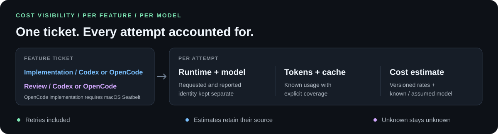
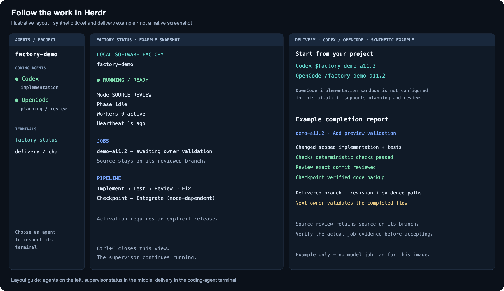

# Software Factory

**From a ticket to a reviewed commit.**

Run feature tickets through local agents, tests and independent review.
Track tokens and estimated cost by ticket, runtime and model.

[](https://github.com/bucholcm/software-factory/releases/latest)
[](https://github.com/bucholcm/software-factory/actions/workflows/tests.yml)
[](pyproject.toml)
[](LICENSE)

[](docs/operations.md#workflow-and-modes)

Start from the project open in your coding agent:

```text
Codex       $factory PROJECT-TICKET
OpenCode    /factory PROJECT-TICKET
```

[Set up your project →](docs/operations.md#run-and-inspect) · [Latest release](https://github.com/bucholcm/software-factory/releases/latest)

## Know what each feature costs

[](docs/usage-and-costs.md)

Inspect each feature ticket's token usage and estimated cost across stages,
models and retries. Estimates require a versioned rate catalog and either a known
model identity or an explicit model assumption. Codex does not report observed model identity;
requested models stay separate. Missing data stays unknown.

```text
Codex       $factory usage PROJECT-TICKET
OpenCode    /factory usage PROJECT-TICKET
```

[Explore costs and model provenance →](docs/usage-and-costs.md)
API-equivalent estimates support spending decisions; automated budget limits are not implemented.

## Codex and OpenCode, one workflow

Configure implementation and review runtimes independently. Run Codex
implementation with OpenCode review, OpenCode implementation with Codex review,
or both stages on one runtime. OpenCode implementation requires macOS Seatbelt.
Select requested models per runtime and start from either coding client.

| Runtime adapter | Implementation | Review |
| --- | --- | --- |
| Codex | Available | Independent exact-commit review |
| OpenCode | macOS only · Seatbelt required | Planning review |

[Configure runtimes and models →](docs/operations.md#runtime-and-model-selection)

## Follow delivery in Herdr

[](docs/images/herdr-factory-status.png)

*Layout illustration with synthetic data, not a native screenshot.*

Your coding session and factory status stay side by side. The supervisor runs
independently of the chat session. [Open the status panel →](docs/operations.md#see-it-in-herdr)

## Plan with Beads and Scotty

[](docs/images/scotty-dependency-graph.png)

*Scotty showing a synthetic demo project with real Beads relations.*

Decisions block their dependent tasks. Independent scoped work can continue.
[Explore the workflow and runnable demo →](docs/beads-scotty-workflow.md)

## Start here

Python 3.11+, Git, Beads, GitHub CLI and an authenticated CLI for the selected
runtime (Codex or OpenCode) are required.
Codex and OpenCode can execute implementation jobs. OpenCode implementation is
currently supported on macOS inside the factory's enforced Seatbelt sandbox.
See the [OpenCode setup](docs/operations.md#opencode-implementation) before enabling it.

| Guide | What you will find |
| --- | --- |
| [Setup and operations](docs/operations.md) | Install the skill, configure a project and choose an execution mode. |
| [Environments and recovery](docs/reliability-loop.md) | Prepare dependencies and investigate or recover failed work. |
| [Tokens and costs](docs/usage-and-costs.md) | Inspect attempts, model provenance and optional price estimates. |
| [Security](SECURITY.md) | Trust boundaries, private data and supported reporting channels. |

This is a pilot for trusted local projects. Configured commands use your account's
permissions. Read the [security assessment](security_best_practices_report.md)
before publishing or deploying it.

Licensed under [MIT](LICENSE).
