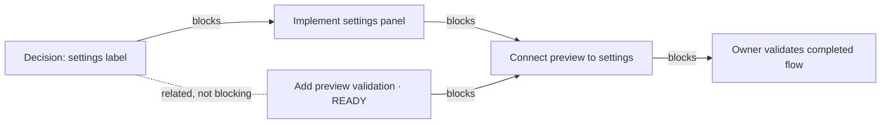

# Working with Beads, Scotty and the factory

The human owns requirements, product decisions and periodic validation of the
finished experience. The coordinator handles decomposition, dependency upkeep,
implementation, tests, independent review and the next eligible action.

| Tool | Responsibility |
| --- | --- |
| [Beads](https://github.com/gastownhall/beads), `bd` | Tasks, ownership, scope, decisions, native dependencies and durable handoff |
| [Bead Me Up, Scotty](https://github.com/brendan-appstart/bead-me-up-scotty) | Browser board, epics and graph over the same Beads records |
| Software Factory | Durable execution journal, worker supervision, checks, review and configured integration |
| Herdr | Agent terminals and live factory status panes |

The board is a view of Beads. The factory execution database contains process
and stage records; it does not replace the project tracker. Herdr shows running
terminals; it is not the task queue.

## A decision blocks only its dependent work



These are actual relations in the synthetic demo below. The settings and
integration tasks wait for their prerequisites. Preview validation is ready
because its files and contracts are independent of the unanswered decision.

Three relation types have different meanings:

- **Parent–child** groups work under an epic. It does not replace a prerequisite.
- **Blocks** records a real prerequisite and affects `bd ready`.
- **Related** connects useful context without blocking work.

The coordinator updates these native edges when scope, dependencies or decisions
change. A dependency mentioned only in a description does not define the graph.
Remove an edge only after its prerequisite is no longer relevant, not to bypass
an unfinished requirement.

## Run the synthetic graph in Scotty

Prerequisites: Git, Python 3.11+, `bd`, and `scotty` on `PATH`. Follow the upstream
installation instructions for [Beads](https://github.com/gastownhall/beads) and
[Scotty](https://github.com/brendan-appstart/bead-me-up-scotty).
This example was verified with Beads 1.3.4 and Scotty 0.4.0.

From the factory checkout:

```sh
python -m scripts.demo_beads --destination /tmp/factory-workflow-demo
```

The destination must be new. The script initializes a separate Git/Beads project
with six synthetic records and native hierarchy, blocking and related edges.
It checks for dependency cycles and verifies that only preview validation is
eligible implementation work. It ignores inherited Beads/Git routing variables,
uses separate demo configuration and does not create factory workers, call a
model, configure a remote or access application data.

Check whether Scotty is already running before starting another instance. If
there is an existing server, add/select the demo project in its project picker.
Otherwise, from the demo directory:

```sh
cd /tmp/factory-workflow-demo
POSTHOG_KEY='' SCOTTY_READ_ONLY=1 scotty --host 127.0.0.1 --no-open
```

Open the printed URL, add/select `/tmp/factory-workflow-demo` if the picker
appears, then choose **Graph**. The graph URL has this form:

```text
http://127.0.0.1:PORT/p/PROJECT_ID?view=graph
```

Use the actual port and project ID from your instance. Verify the selected
project is the demo directory and the data source is **bd/live**, not Scotty's
built-in demo dataset. The local doctor endpoint for the selected project also
reports `kind: "bd"` and the repository path.

The empty `POSTHOG_KEY` disables usage reporting for this instance. Read-only
mode is a viewing preference, not an access-control boundary. Bind to loopback;
the factory does not add remote authentication or secure hosting to Scotty.
To keep the demo out of your usual Scotty project list, give this new instance
a separate `XDG_CONFIG_HOME`, for example `/tmp/factory-scotty-config`.

Inspect the same data with the CLI:

```sh
bd list --json
bd ready --json
bd blocked
bd dep list demo-a11.3
bd dep cycles
```

The only ready implementation is `demo-a11.2`. The epic and decision are not
implementation jobs. Answer the example decision only when you want to change
the demo state:

```sh
bd close demo-d01 --reason='Use Project settings as the visible label.'
bd ready --json
```

This unblocks `demo-a11.1`. The integration task still waits for its two actual
prerequisites. Merely answering the decision does not start a factory worker.

## The project workflow

1. **Recover context.** Read the repository instructions and `bd prime`. Inspect
   owned active work, work in review, `bd blocked`, `bd ready`, live workers and
   unresolved GitHub review threads before claiming something new.
2. **Prepare the ticket.** Record requirements, acceptance criteria, explicit
   `factory_paths`, prerequisites and the next action. Preserve other owners'
   active work. Do not copy secrets or application data into tasks or examples.
3. **Handle product decisions.** Create a separate `decision` with a concrete
   question, recommendation, alternatives and effect on scope. Add
   `bd dep add DEPENDENT DECISION`. A substantive close reason records the
   answer; unrelated eligible work continues.
4. **Execute in isolation.** Claim work atomically and use a separate branch and
   worktree. The coordination policy allows at most two implementation jobs
   globally, only after checking file and contract independence. The pilot
   factory default is one active worker. Work in review still reserves its
   contracts; review and manual-validation tickets do not consume new
   implementation slots.
5. **Test and review the exact revision.** The worker implements; deterministic
   gates run; a separate review session checks the actual commit. Fix findings,
   rerun checks and review the changed revision. Do not manufacture approval
   metadata or treat an old approval as applying to a new commit.
6. **Integrate according to project mode.** In `source-review`, the source change
   stays tested/reviewed on its branch. `source-integrate` additionally requires
   the configured security checks, runtime-separated integration checkout and
   verified code checkpoint. Application activation is a separate explicit step.
7. **Reconcile the tracker.** Store the actual stage, owner, branch/worktree,
   revision, reviewer/result, blocker and next action. Keep a PR link when one
   exists. Close only owned work whose completion/integration has been verified.
   The current pilot integrates locally and does not automatically create/push
   GitHub PRs. Follow repository authorization for Git/Dolt remote sync.

Automated E2E tests belong to the agents. The owner periodically validates a
coherent product flow using a short scenario pack with expected outcomes and
product questions. This is not a request to manually test every commit.

## Hand a real ticket to the factory

From that project's Codex or OpenCode session:

```text
Codex:     $factory PROJECT-TICKET
OpenCode:  /factory PROJECT-TICKET
```

The project needs its own factory configuration and a running, ready supervisor.
The Beads intake requires an open, unassigned ticket with `factory-pilot` and
`ready-for-development` labels, a valid `factory_paths` list and no unresolved
blocking prerequisites. The skill checks requirements/scope before adding
readiness labels. It must not remove a real dependency to make the task ready.

For example, scoped metadata for a synthetic settings task could be:

```json
{
  "factory_paths": ["src/settings.py", "tests/test_settings.py"]
}
```

In Codex or OpenCode, `$factory graph` or `/factory graph` asks the coordinator
to show the current project's Scotty graph. `$factory board` / `/factory board`
opens the board instead. These are viewing requests and do not submit a task.

The built-in tracker adapter already implements scoped intake, native product
decision edges, independent worker review and stage reconciliation. Scotty
provides the visual graph over those records. The synthetic example is a
reproducible demonstration, not a second scheduler or a substitute board.
